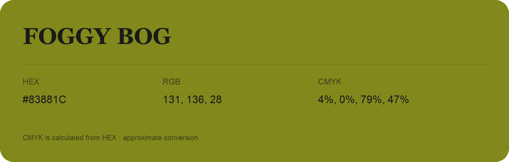

## Foggy Bog

- HEX: #83881C
- RGB: 131, 136, 28
- CMYK: 4%, 0%, 79%, 47%
- Character: sunny, lively, optimistic
- Suggested uses: friendly consumer brands, food packaging, cheerful accents

- Source images: IMG_9111.JPG

- Data provenance: CMYK calculated from HEX using the page’s conversion; source image CMYK was unreadable. This is an approximate conversion without a print color profile.
