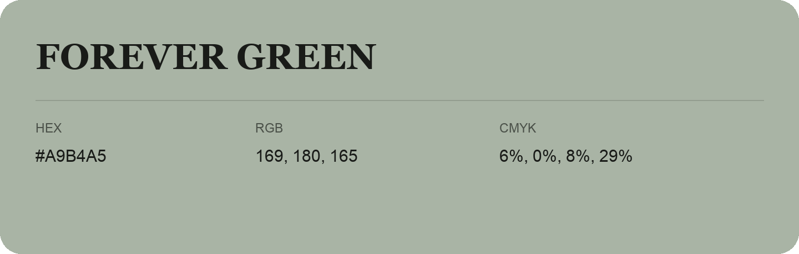

## Forever Green

- HEX: #A9B4A5
- RGB: 169, 180, 165
- CMYK: 6%, 0%, 8%, 29%
- Character: quiet, balanced, understated
- Suggested uses: professional services, minimal identities, supporting backgrounds

- Source images: IMG_9083.JPG
