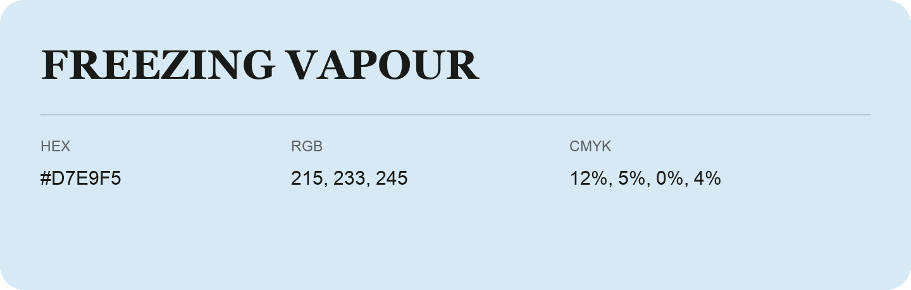

## Freezing Vapour

- HEX: #D7E9F5
- RGB: 215, 233, 245
- CMYK: 12%, 5%, 0%, 4%
- Character: quiet, balanced, understated
- Suggested uses: professional services, minimal identities, supporting backgrounds

- Source images: IMG_9103.JPG

- Data provenance: RGB calculated from HEX, matching the page; source image RGB was unreadable.
