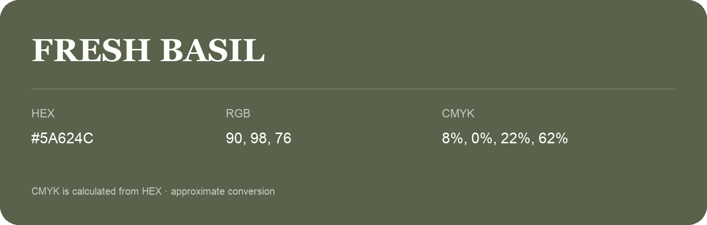

## Fresh Basil

- HEX: #5A624C
- RGB: 90, 98, 76
- CMYK: 8%, 0%, 22%, 62%
- Character: natural, grounded, fresh
- Suggested uses: outdoor businesses, wellness brands, organic packaging

- Source images: IMG_9055.JPG

- Data provenance: CMYK calculated from HEX using the page’s conversion; source image CMYK was unreadable. This is an approximate conversion without a print color profile.
