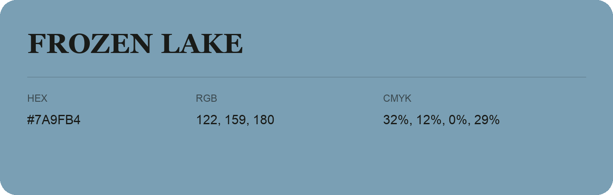

## Frozen Lake

- HEX: #7A9FB4
- RGB: 122, 159, 180
- CMYK: 32%, 12%, 0%, 29%
- Character: cool, composed, dependable
- Suggested uses: professional services, technology brands, calm backgrounds

- Source images: IMG_9048.JPG
