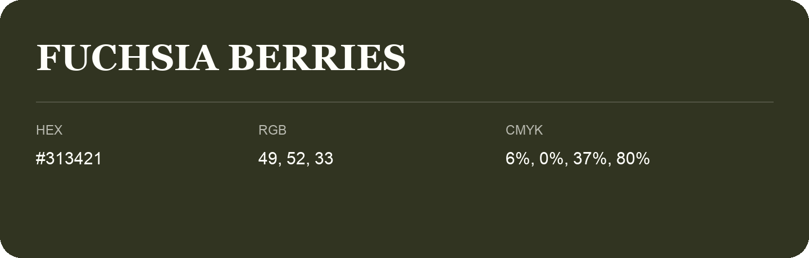

## Fuchsia Berries

- HEX: #313421
- RGB: 49, 52, 33
- CMYK: 6%, 0%, 37%, 80%
- Character: deep, grounded, understated
- Suggested uses: premium packaging, editorial typography, dark backgrounds

- Source images: IMG_9028.JPG

- Name note: Other distinct shades share this name: [fuchsia-berries-33351c](fuchsia-berries-33351c.md), [fuchsia-berries-363922](fuchsia-berries-363922.md).
