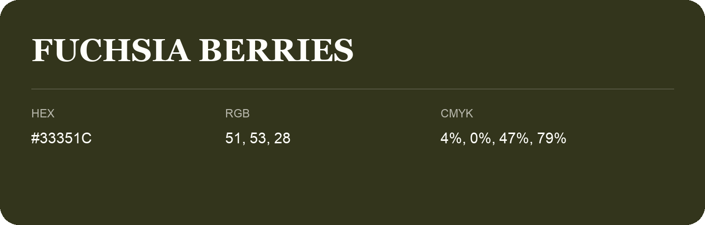

## Fuchsia Berries

- HEX: #33351C
- RGB: 51, 53, 28
- CMYK: 4%, 0%, 47%, 79%
- Character: deep, grounded, understated
- Suggested uses: premium packaging, editorial typography, dark backgrounds

- Source images: IMG_9106.JPG

- Name note: Other distinct shades share this name: [fuchsia-berries-313421](fuchsia-berries-313421.md), [fuchsia-berries-363922](fuchsia-berries-363922.md).
