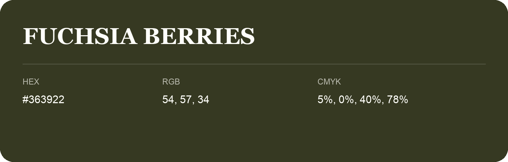

## Fuchsia Berries

- HEX: #363922
- RGB: 54, 57, 34
- CMYK: 5%, 0%, 40%, 78%
- Character: deep, grounded, understated
- Suggested uses: premium packaging, editorial typography, dark backgrounds

- Source images: iCloud Photos 2/IMG_9180.JPG

- Name note: Other distinct shades share this name: [fuchsia-berries-313421](fuchsia-berries-313421.md), [fuchsia-berries-33351c](fuchsia-berries-33351c.md).
