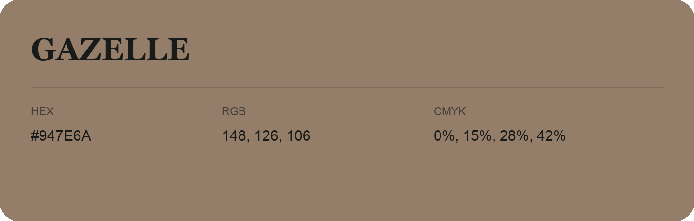

## Gazelle

- HEX: #947E6A
- RGB: 148, 126, 106
- CMYK: 0%, 15%, 28%, 42%
- Character: earthy, rich, warm
- Suggested uses: artisan businesses, hospitality brands, warm accents

- Source images: IMG_9112.JPG
