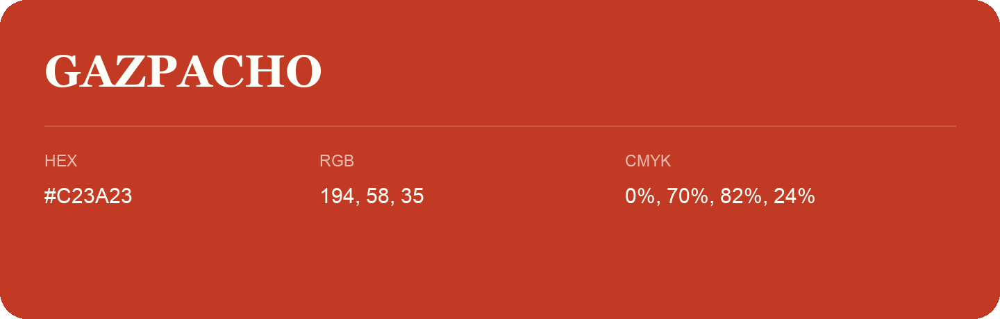

## Gazpacho

- HEX: #C23A23
- RGB: 194, 58, 35
- CMYK: 0%, 70%, 82%, 24%
- Character: warm, expressive, energetic
- Suggested uses: food brands, expressive identities, promotional accents

- Source images: IMG_9079.JPG
