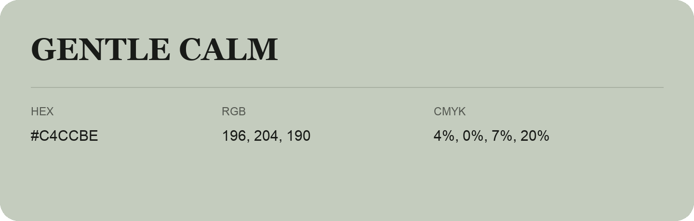

## Gentle Calm

- HEX: #C4CCBE
- RGB: 196, 204, 190
- CMYK: 4%, 0%, 7%, 20%
- Character: quiet, balanced, understated
- Suggested uses: professional services, minimal identities, supporting backgrounds

- Source images: IMG_9043.JPG
