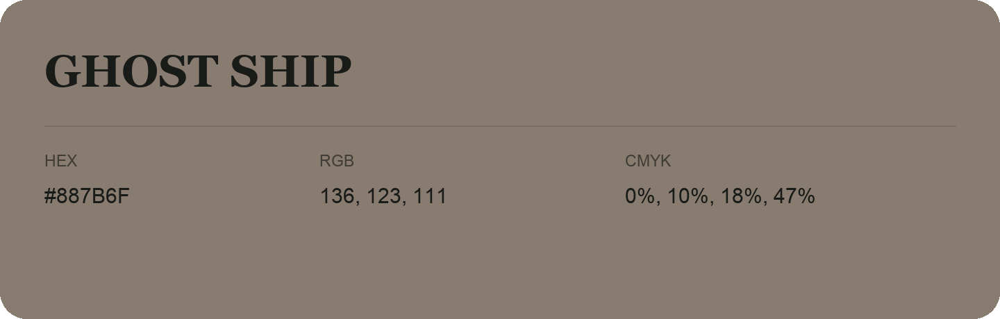

## Ghost Ship

- HEX: #887B6F
- RGB: 136, 123, 111
- CMYK: 0%, 10%, 18%, 47%
- Character: earthy, rich, warm
- Suggested uses: premium packaging, rustic brands, dark backgrounds

- Source images: IMG_9026.JPG
