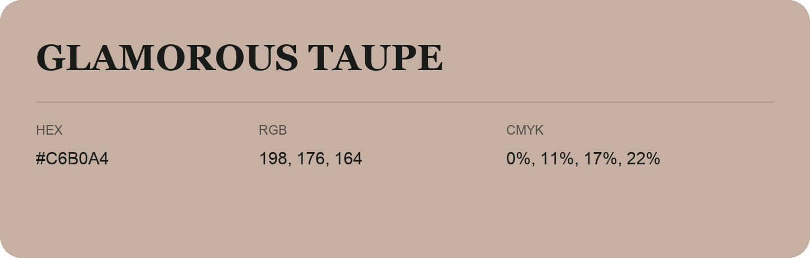

## Glamorous Taupe

- HEX: #C6B0A4
- RGB: 198, 176, 164
- CMYK: 0%, 11%, 17%, 22%
- Character: soft, gentle, approachable
- Suggested uses: friendly consumer brands, gentle backgrounds, welcoming accents

- Source images: IMG_9080.JPG

- Data provenance: HEX recovered from page data; cross-checked against the recognized source text with visually equivalent glyphs.
- Data provenance: RGB calculated from HEX, matching the page; source image RGB was unreadable.
