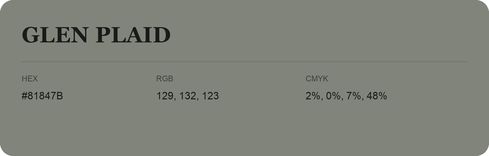

## Glen Plaid

- HEX: #81847B
- RGB: 129, 132, 123
- CMYK: 2%, 0%, 7%, 48%
- Character: quiet, balanced, understated
- Suggested uses: professional services, minimal identities, supporting backgrounds

- Source images: IMG_9115.JPG
