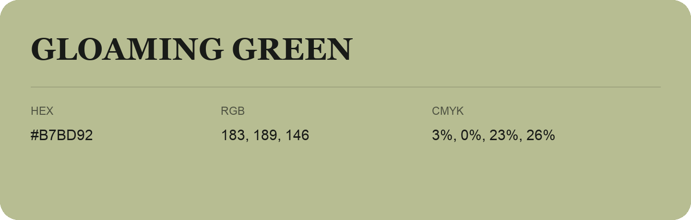

## Gloaming Green

- HEX: #B7BD92
- RGB: 183, 189, 146
- CMYK: 3%, 0%, 23%, 26%
- Character: sunny, lively, optimistic
- Suggested uses: friendly consumer brands, food packaging, cheerful accents

- Source images: iCloud Photos 2/IMG_9139.JPG
- Data provenance: RGB calculated from HEX; source text recognition was uncertain.
