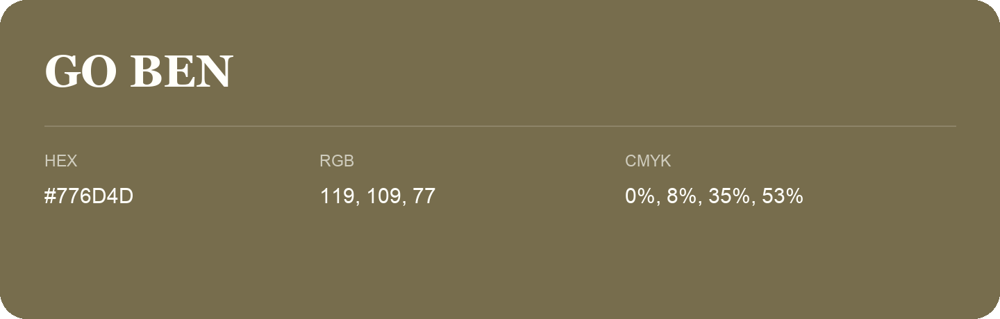

## Go Ben

- HEX: #776D4D
- RGB: 119, 109, 77
- CMYK: 0%, 8%, 35%, 53%
- Character: sunny, lively, optimistic
- Suggested uses: friendly consumer brands, food packaging, cheerful accents

- Source images: IMG_9040.JPG
