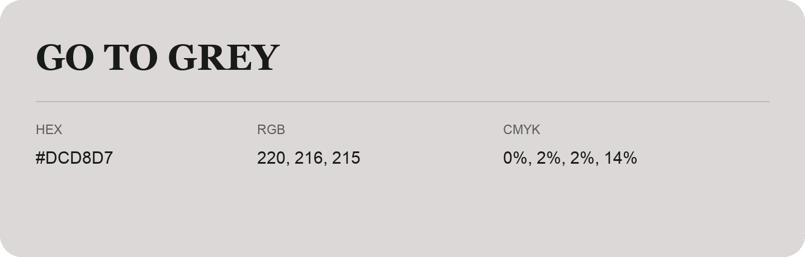

## Go To Grey

- HEX: #DCD8D7
- RGB: 220, 216, 215
- CMYK: 0%, 2%, 2%, 14%
- Character: quiet, balanced, understated
- Suggested uses: professional services, minimal identities, supporting backgrounds

- Source images: IMG_8977.JPG
