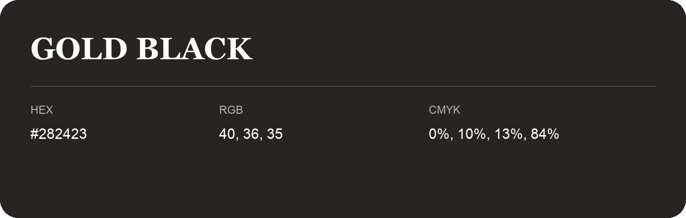

## Gold Black

- HEX: #282423
- RGB: 40, 36, 35
- CMYK: 0%, 10%, 13%, 84%
- Character: deep, grounded, understated
- Suggested uses: premium packaging, editorial typography, dark backgrounds

- Source images: IMG_9007.JPG

- Name note: Other distinct shades share this name: [gold-black-292222](gold-black-292222.md), [gold-black-2c2220](gold-black-2c2220.md).
