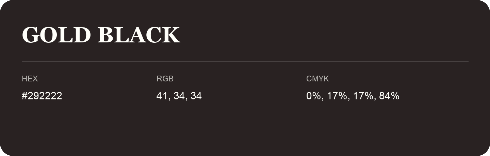

## Gold Black

- HEX: #292222
- RGB: 41, 34, 34
- CMYK: 0%, 17%, 17%, 84%
- Character: deep, grounded, understated
- Suggested uses: premium packaging, editorial typography, dark backgrounds

- Source images: IMG_9097.JPG

- Name note: Other distinct shades share this name: [gold-black-282423](gold-black-282423.md), [gold-black-2c2220](gold-black-2c2220.md).
