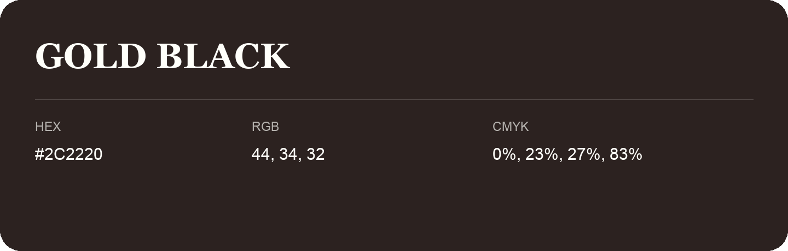

## Gold Black

- HEX: #2C2220
- RGB: 44, 34, 32
- CMYK: 0%, 23%, 27%, 83%
- Character: deep, grounded, understated
- Suggested uses: premium packaging, editorial typography, dark backgrounds

- Source images: IMG_8996.JPG

- Name note: Other distinct shades share this name: [gold-black-282423](gold-black-282423.md), [gold-black-292222](gold-black-292222.md).
