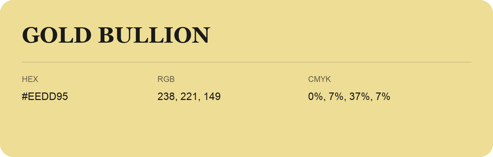

## Gold Bullion

- HEX: #EEDD95
- RGB: 238, 221, 149
- CMYK: 0%, 7%, 37%, 7%
- Character: soft, gentle, approachable
- Suggested uses: friendly consumer brands, gentle backgrounds, welcoming accents

- Source images: IMG_9095.JPG

- Data provenance: RGB calculated from HEX, matching the page; source image RGB was unreadable.
