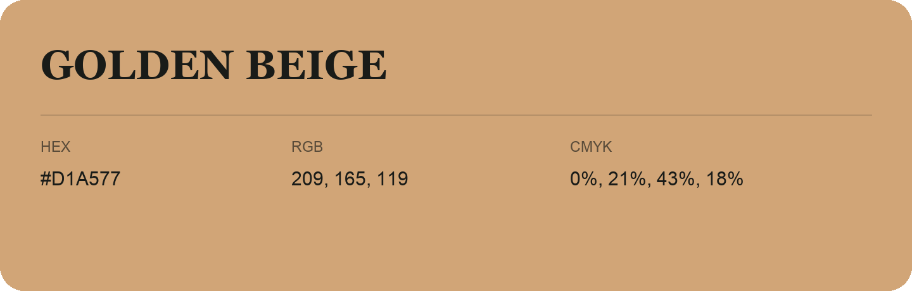

## Golden Beige

- HEX: #D1A577
- RGB: 209, 165, 119
- CMYK: 0%, 21%, 43%, 18%
- Character: earthy, rich, warm
- Suggested uses: artisan businesses, hospitality brands, warm accents

- Source images: IMG_9093.JPG
