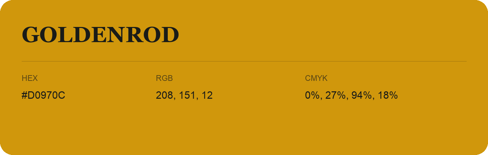

## Goldenrod

- HEX: #D0970C
- RGB: 208, 151, 12
- CMYK: 0%, 27%, 94%, 18%
- Character: earthy, rich, warm
- Suggested uses: artisan businesses, hospitality brands, warm accents

- Source images: IMG_8990.JPG
