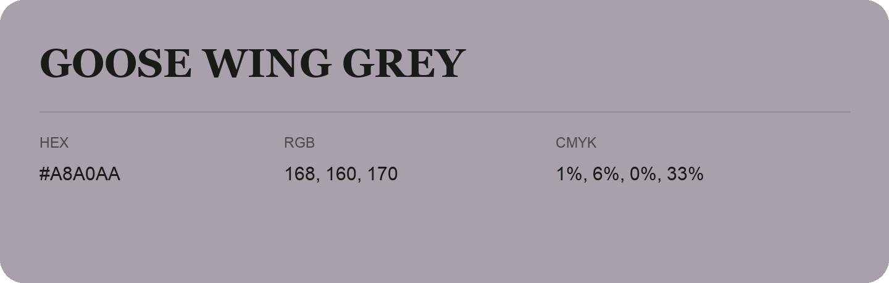

## Goose Wing Grey

- HEX: #A8A0AA
- RGB: 168, 160, 170
- CMYK: 1%, 6%, 0%, 33%
- Character: quiet, balanced, understated
- Suggested uses: professional services, minimal identities, supporting backgrounds

- Source images: IMG_9007.JPG

- Data provenance: HEX recovered from page data; cross-checked against the recognized source text with visually equivalent glyphs.
- Data provenance: RGB calculated from HEX, matching the page; source image RGB was unreadable.
