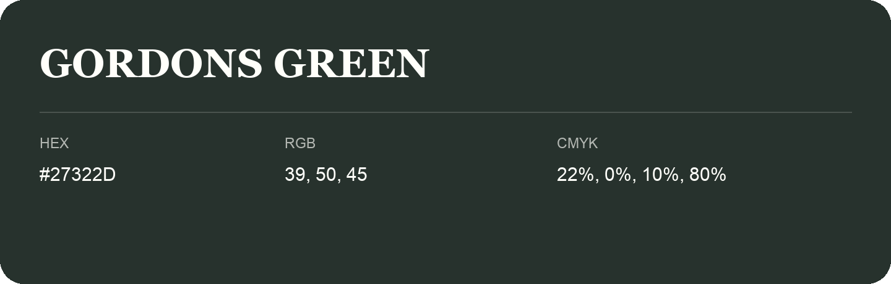

## Gordons Green

- HEX: #27322D
- RGB: 39, 50, 45
- CMYK: 22%, 0%, 10%, 80%
- Character: natural, grounded, fresh
- Suggested uses: outdoor businesses, wellness brands, organic packaging

- Source images: IMG_9047-1.JPG
