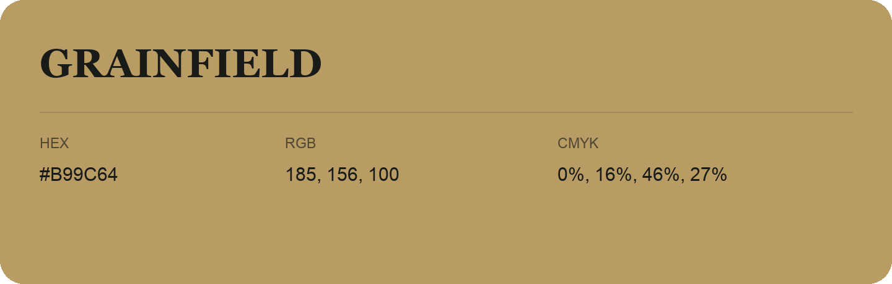

## Grainfield

- HEX: #B99C64
- RGB: 185, 156, 100
- CMYK: 0%, 16%, 46%, 27%
- Character: earthy, rich, warm
- Suggested uses: artisan businesses, hospitality brands, warm accents

- Source images: IMG_9075.JPG
