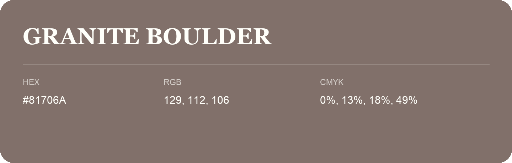

## Granite Boulder

- HEX: #81706A
- RGB: 129, 112, 106
- CMYK: 0%, 13%, 18%, 49%
- Character: earthy, rich, warm
- Suggested uses: premium packaging, rustic brands, dark backgrounds

- Source images: IMG_9001.JPG
