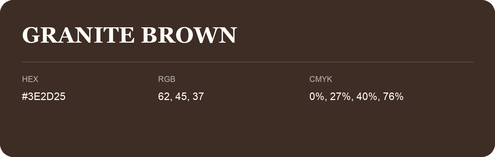

## Granite Brown

- HEX: #3E2D25
- RGB: 62, 45, 37
- CMYK: 0%, 27%, 40%, 76%
- Character: earthy, rich, warm
- Suggested uses: premium packaging, rustic brands, dark backgrounds

- Source images: IMG_9083.JPG
