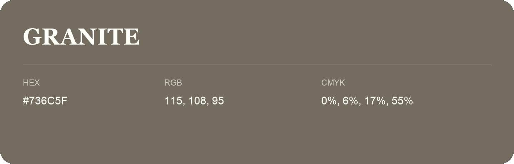

## Granite

- HEX: #736C5F
- RGB: 115, 108, 95
- CMYK: 0%, 6%, 17%, 55%
- Character: earthy, rich, warm
- Suggested uses: premium packaging, rustic brands, dark backgrounds

- Source images: iCloud Photos 2/IMG_9149.JPG
