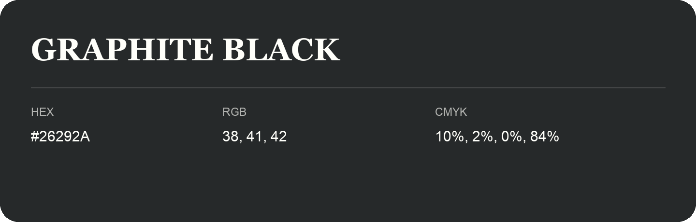

## Graphite Black

- HEX: #26292A
- RGB: 38, 41, 42
- CMYK: 10%, 2%, 0%, 84%
- Character: restrained, grounded, sophisticated
- Suggested uses: premium brands, editorial typography, dark backgrounds

- Source images: IMG_9046.JPG
