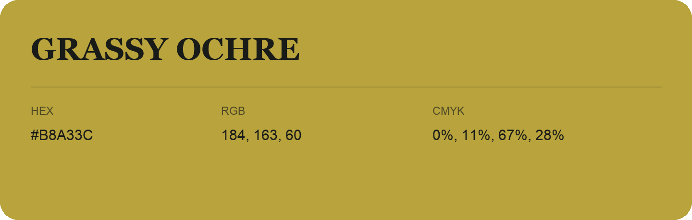

## Grassy Ochre

- HEX: #B8A33C
- RGB: 184, 163, 60
- CMYK: 0%, 11%, 67%, 28%
- Character: sunny, lively, optimistic
- Suggested uses: friendly consumer brands, food packaging, cheerful accents

- Source images: IMG_9027.JPG
