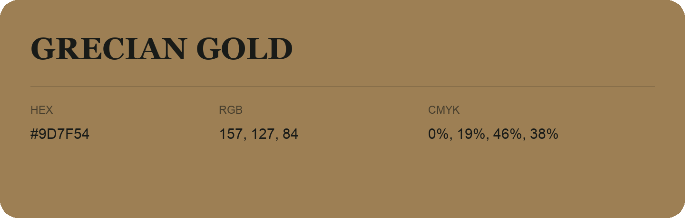

## Grecian Gold

- HEX: #9D7F54
- RGB: 157, 127, 84
- CMYK: 0%, 19%, 46%, 38%
- Character: earthy, rich, warm
- Suggested uses: artisan businesses, hospitality brands, warm accents

- Source images: IMG_9020.JPG

- Data provenance: RGB calculated from HEX, matching the page; source image RGB was unreadable.
