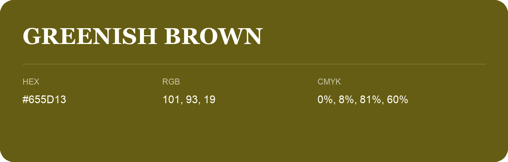

## Greenish Brown

- HEX: #655D13
- RGB: 101, 93, 19
- CMYK: 0%, 8%, 81%, 60%
- Character: sunny, lively, optimistic
- Suggested uses: friendly consumer brands, food packaging, cheerful accents

- Source images: IMG_9042.JPG
