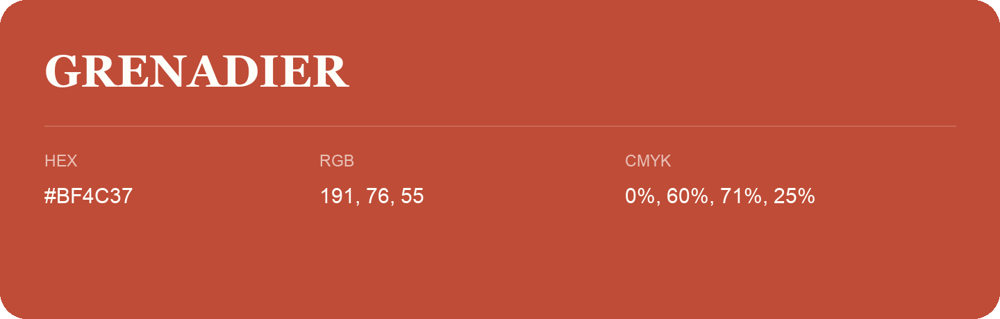

## Grenadier

- HEX: #BF4C37
- RGB: 191, 76, 55
- CMYK: 0%, 60%, 71%, 25%
- Character: warm, expressive, energetic
- Suggested uses: food brands, expressive identities, promotional accents

- Source images: IMG_9117.JPG
