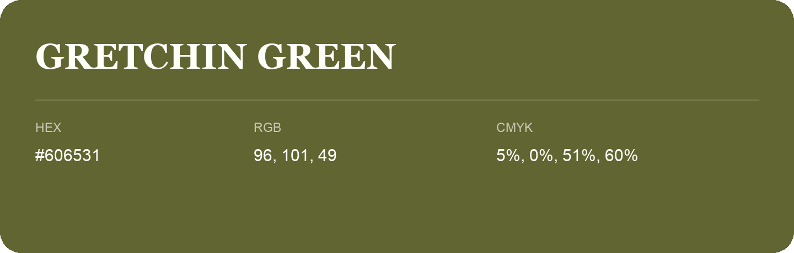

## Gretchin Green

- HEX: #606531
- RGB: 96, 101, 49
- CMYK: 5%, 0%, 51%, 60%
- Character: sunny, lively, optimistic
- Suggested uses: friendly consumer brands, food packaging, cheerful accents

- Source images: iCloud Photos 2/IMG_9178.JPG
