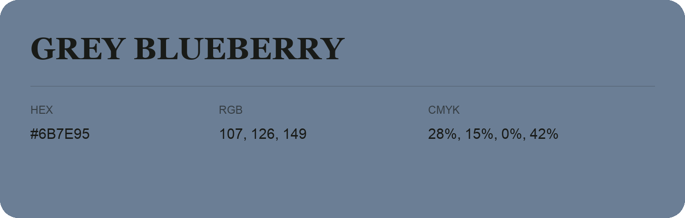

## Grey Blueberry

- HEX: #6B7E95
- RGB: 107, 126, 149
- CMYK: 28%, 15%, 0%, 42%
- Character: cool, composed, dependable
- Suggested uses: professional services, technology brands, calm backgrounds

- Source images: IMG_9085.JPG
