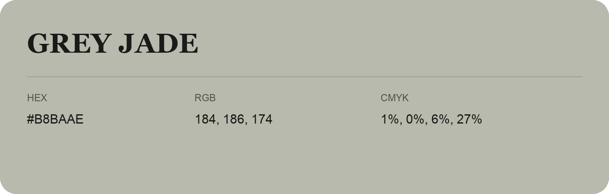

## Grey Jade

- HEX: #B8BAAE
- RGB: 184, 186, 174
- CMYK: 1%, 0%, 6%, 27%
- Character: quiet, balanced, understated
- Suggested uses: professional services, minimal identities, supporting backgrounds

- Source images: iCloud Photos 2/IMG_9150.JPG
