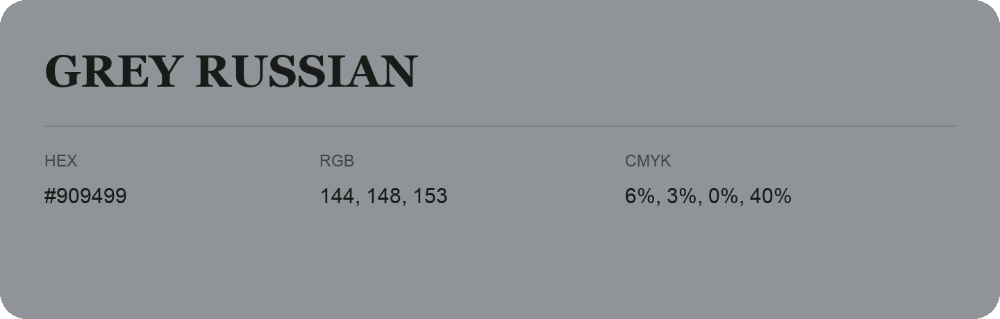

## Grey Russian

- HEX: #909499
- RGB: 144, 148, 153
- CMYK: 6%, 3%, 0%, 40%
- Character: quiet, balanced, understated
- Suggested uses: professional services, minimal identities, supporting backgrounds

- Source images: IMG_9094.JPG
