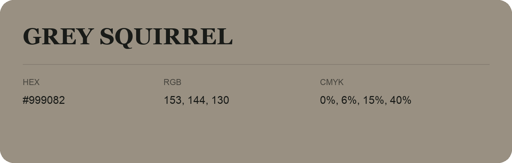

## Grey Squirrel

- HEX: #999082
- RGB: 153, 144, 130
- CMYK: 0%, 6%, 15%, 40%
- Character: earthy, rich, warm
- Suggested uses: artisan businesses, hospitality brands, warm accents

- Source images: IMG_9055.JPG

- Data provenance: RGB calculated from HEX, matching the page; source image RGB was unreadable.
