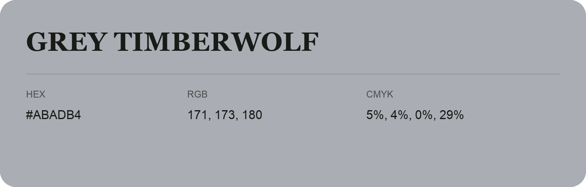

## Grey Timberwolf

- HEX: #ABADB4
- RGB: 171, 173, 180
- CMYK: 5%, 4%, 0%, 29%
- Character: quiet, balanced, understated
- Suggested uses: professional services, minimal identities, supporting backgrounds

- Source images: iCloud Photos 2/IMG_9186.JPG
- Data provenance: RGB calculated from HEX; source text recognition was uncertain.
