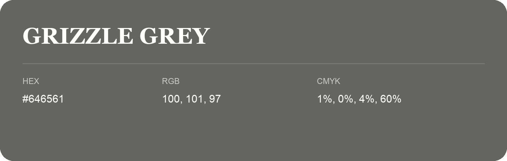

## Grizzle Grey

- HEX: #646561
- RGB: 100, 101, 97
- CMYK: 1%, 0%, 4%, 60%
- Character: restrained, grounded, sophisticated
- Suggested uses: premium brands, editorial typography, dark backgrounds

- Source images: IMG_9076.JPG
