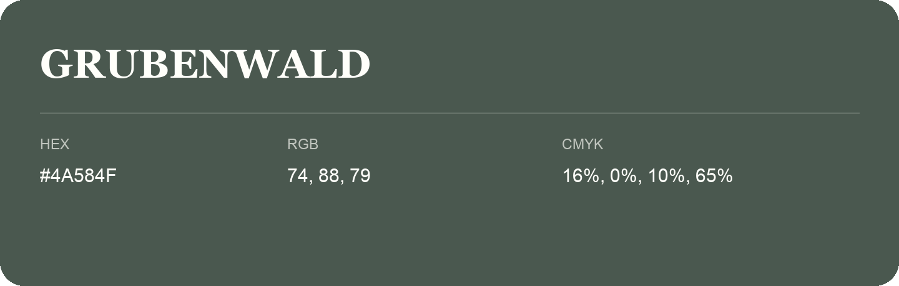

## Grubenwald

- HEX: #4A584F
- RGB: 74, 88, 79
- CMYK: 16%, 0%, 10%, 65%
- Character: natural, grounded, fresh
- Suggested uses: outdoor businesses, wellness brands, organic packaging

- Source images: IMG_9047-1.JPG
