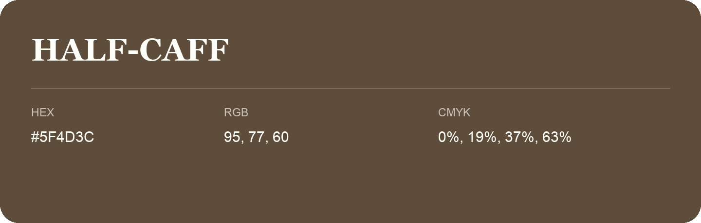

## Half-Caff

- HEX: #5F4D3C
- RGB: 95, 77, 60
- CMYK: 0%, 19%, 37%, 63%
- Character: earthy, rich, warm
- Suggested uses: premium packaging, rustic brands, dark backgrounds

- Source images: IMG_9045.JPG
