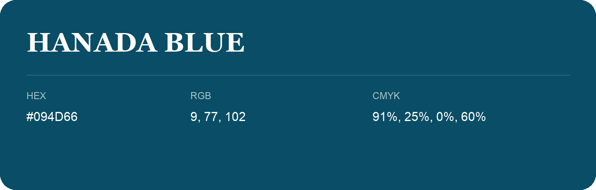

## Hanada Blue

- HEX: #094D66
- RGB: 9, 77, 102
- CMYK: 91%, 25%, 0%, 60%
- Character: calm, fresh, composed
- Suggested uses: wellness brands, coastal hospitality, modern service brands

- Source images: iCloud Photos 2/IMG_9149.JPG
