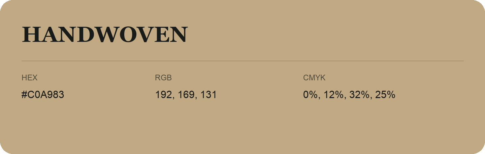

## Handwoven

- HEX: #C0A983
- RGB: 192, 169, 131
- CMYK: 0%, 12%, 32%, 25%
- Character: soft, gentle, approachable
- Suggested uses: friendly consumer brands, gentle backgrounds, welcoming accents

- Source images: IMG_9099.JPG

- Data provenance: HEX recovered from page data; cross-checked against the readable source RGB.
