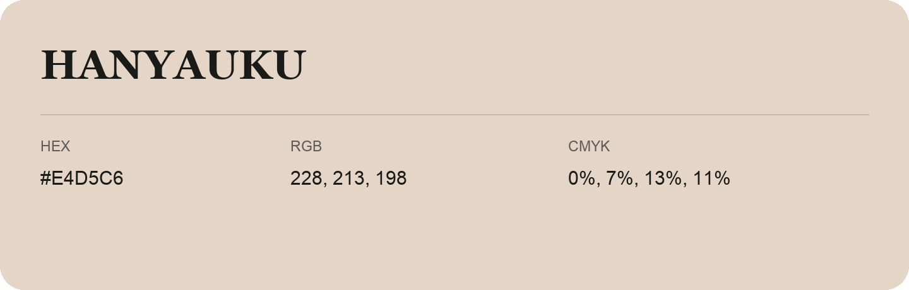

## Hanyauku

- HEX: #E4D5C6
- RGB: 228, 213, 198
- CMYK: 0%, 7%, 13%, 11%
- Character: soft, gentle, approachable
- Suggested uses: friendly consumer brands, gentle backgrounds, welcoming accents

- Source images: iCloud Photos 2/IMG_9152.JPG
- Data provenance: RGB calculated from HEX; source text recognition was uncertain.
