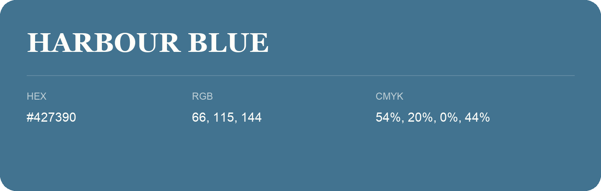

## Harbour Blue

- HEX: #427390
- RGB: 66, 115, 144
- CMYK: 54%, 20%, 0%, 44%
- Character: cool, composed, dependable
- Suggested uses: professional services, technology brands, calm backgrounds

- Source images: iCloud Photos 2/IMG_9157.JPG
- Data provenance: RGB calculated from HEX; source text recognition was uncertain.
