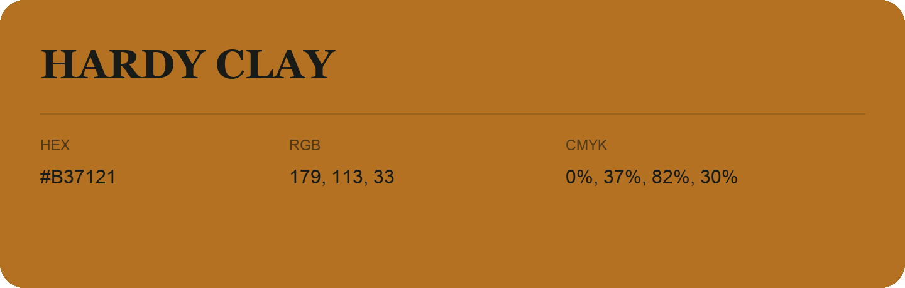

## Hardy Clay

- HEX: #B37121
- RGB: 179, 113, 33
- CMYK: 0%, 37%, 82%, 30%
- Character: earthy, rich, warm
- Suggested uses: artisan businesses, hospitality brands, warm accents

- Source images: iCloud Photos 2/IMG_9157.JPG
