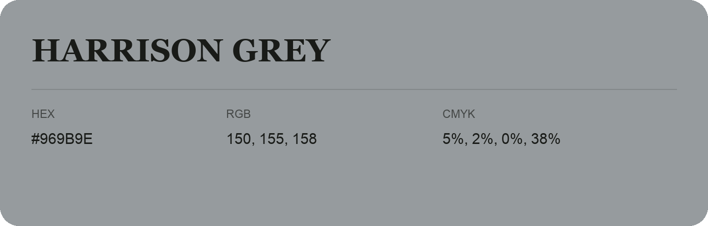

## Harrison Grey

- HEX: #969B9E
- RGB: 150, 155, 158
- CMYK: 5%, 2%, 0%, 38%
- Character: quiet, balanced, understated
- Suggested uses: professional services, minimal identities, supporting backgrounds

- Source images: iCloud Photos 2/IMG_9134.JPG
