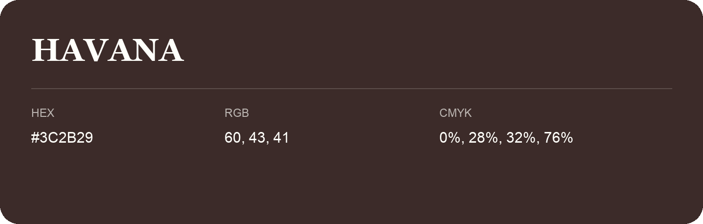

## Havana

- HEX: #3C2B29
- RGB: 60, 43, 41
- CMYK: 0%, 28%, 32%, 76%
- Character: warm, expressive, energetic
- Suggested uses: food brands, expressive identities, promotional accents

- Source images: IMG_9110.JPG
